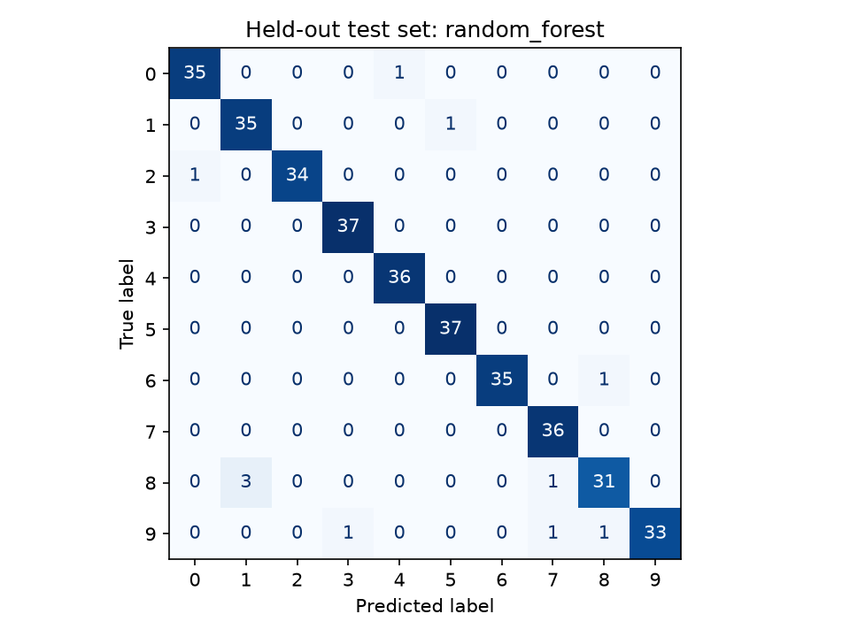
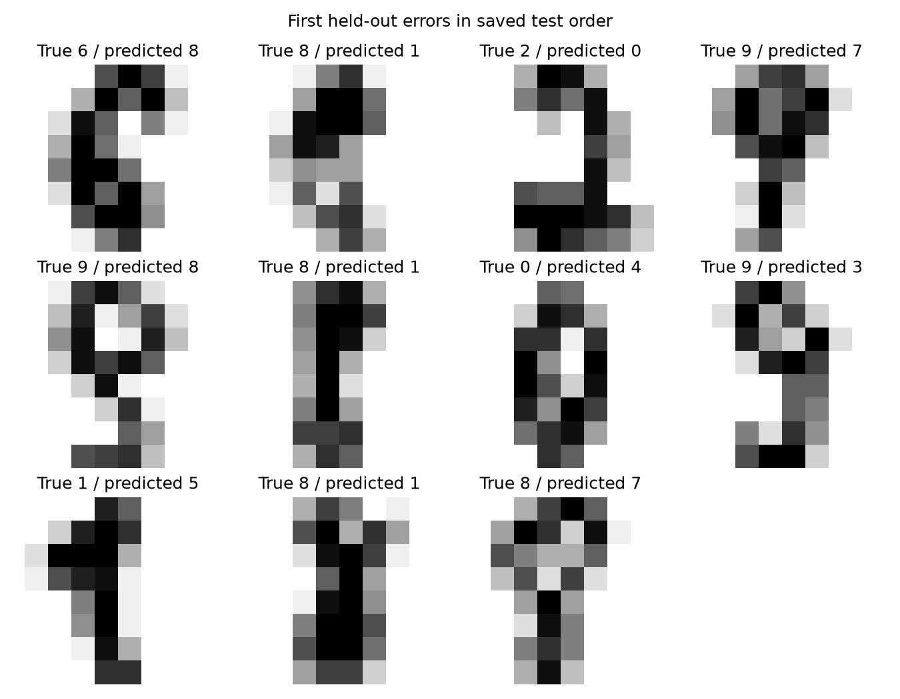

# Handwritten Digits: Classical ML Benchmark

A reproducible classification workflow for scikit-learn's bundled 8x8 handwritten
digits dataset. Compare a majority-class baseline, logistic regression, KNN, and
a random forest; select on validation macro F1, then evaluate the selected model
on a held-out test set.

This learning project benchmarks a small educational dataset. Its results do not
establish performance on arbitrary handwriting or photographs.

## Reproduce

Requires Python 3.12. From this repository directory:

```bash
python -m venv .venv
# Windows: .venv\Scripts\activate
# macOS/Linux: source .venv/bin/activate
python -m pip install -r requirements.txt
python -m pytest -q
python -m digits_benchmark.train
python -m digits_benchmark.predict reports/demo_digit.csv
```

The final command predicts a held-out sample exported by training. Its true label
is saved in `reports/demo_label.txt`. It is a reproducibility demo, not an unseen
external-image evaluation. You can supply your own 8x8 CSV with intensities 0-16;
arbitrary photos need different preprocessing and separate evaluation.

## Experimental protocol

1. Stratify 1,797 samples into 60% training, 20% validation, 20% test, seed 42.
2. Fit each candidate on training rows. Scalers live inside pipelines and are
   fitted only on those rows.
3. Select by validation macro F1, with declaration order breaking exact ties.
4. Refit that chosen model on training plus validation rows.
5. Evaluate the final model and majority baseline on the test set. Save every
   test prediction, confusion matrix, per-class metrics, and first error examples.

The test set is not consulted for model selection. If further experiments are
chosen after reviewing its errors, treat this test set as development data and
obtain fresh evaluation data before making stronger generalization claims.

## Outputs

- `reports/metrics.json`: actual metrics, package versions, seed, dataset hash.
- `reports/split_indices.json`: exact train/validation/test membership.
- `reports/predictions.csv`: auditable held-out predictions.
- `reports/confusion_matrix.png` and `reports/error_examples.png`: evaluation plots.
- `reports/model.joblib`: generated locally, excluded from Git; load only a model
  you created or trust because joblib is a Python object serialization format.





## Limits and next experiments

The samples are small, centered, low-resolution digits. A random split is not a
writer-independent split. One test score has sampling uncertainty and does not
measure robustness to photographs, rotation, or new writing styles. No test-score
threshold is used as a unit test.

Next steps: repeated validation experiments, a learning curve, runtime comparison,
and a separately collected evaluation set with explicit data-use permission.
Read [MODEL_CARD.md](MODEL_CARD.md) for the intended scope and review questions.

## Dataset provenance

Data is loaded from [scikit-learn's bundled digits dataset](https://scikit-learn.org/stable/modules/generated/sklearn.datasets.load_digits.html),
which documents its relationship to the [UCI Optical Recognition of Handwritten Digits dataset](https://archive.ics.uci.edu/dataset/80/optical+recognition+of+handwritten+digits).
Dataset attribution and terms remain with their original source; the repository's
MIT license covers project code. No external data download is needed to run.
